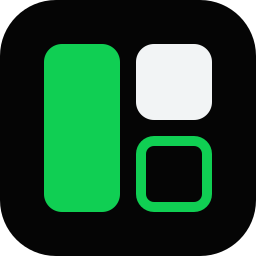

<p align="center"></p>

# nava-ui

A small, dark-first UI kit in plain CSS: the design tokens and components of
[allan-nava.github.io](https://allan-nava.github.io), extracted so that other projects can share
the same look.

- **No build step, no framework.** One stylesheet, one optional script of about 6 KB.
- **Two themes.** Dark by default, light when the system asks for it, and an explicit choice that
  wins over both.
- **Token-driven.** Components read CSS custom properties and nothing else: to re-theme, override
  tokens.
- **Namespaced.** Every class starts with `nv-`, every custom property with `--nv-`.

**Live documentation, with every component and its HTML: <https://allan-nava.github.io/nava-ui/>**

## Contents

- [Install](#install)
- [Quick start](#quick-start)
- [What is in the box](#what-is-in-the-box)
- [Tokens](#tokens)
- [Page templates](#page-templates)
- [React](#react)
- [Components](#components)
- [Tokens for other tools](#tokens-for-other-tools)
- [Theming](#theming)
  - [Cascade layers](#cascade-layers)
- [JavaScript](#javascript)
- [Accessibility](#accessibility)
- [Differences from the site](#differences-from-the-site)
- [Development](#development)
- [License and credits](#license-and-credits)

## Install

Pick one.

**From npm**, with the React wrappers if you want them:

```bash
npm install nava-ui
npm install @allan_nava/nava-ui-react   # optional, React 18 or later
```

```js
import 'nava-ui';                        // dist/nava-ui.css: tokens, base, components
import 'nava-ui/components.css';         // or: tokens and components only
import 'nava-ui/js';                     // optional: theme toggle, dismiss, toasts, dialogs, tabs
```

The package carries `dist/`, the sources in `css/` and `src/`, and the font in `fonts/`, which
`dist/nava-ui.css` loads from `../fonts/`. Short paths: `nava-ui/tailwind.css`,
`nava-ui/tailwind-preset`, `nava-ui/tokens.dark.json`, `nava-ui/tokens.light.json`; any file
by its path, such as `nava-ui/dist/nava-ui.min.css`.

**From a CDN**, pinned to a release tag:

```html
<link rel="stylesheet" href="https://cdn.jsdelivr.net/gh/Allan-Nava/nava-ui@v0.9.0/dist/nava-ui.css">
<script defer src="https://cdn.jsdelivr.net/gh/Allan-Nava/nava-ui@v0.9.0/dist/nava-ui.js"></script>
```

Each file also comes minified, same content: `nava-ui.min.css`, `nava-ui.components.min.css`
and `nava-ui.min.js`, next to the readable ones. Sizes at v0.8.0:

| File | Size | Gzipped |
|---|---|---|
| `dist/nava-ui.css` | 73.5 KB | 16.5 KB |
| `dist/nava-ui.min.css` | 45.4 KB | 8.7 KB |
| `dist/nava-ui.components.css` | 68.9 KB | 15.4 KB |
| `dist/nava-ui.components.min.css` | 42.1 KB | 8.0 KB |
| `dist/nava-ui.js` | 8.3 KB | 2.9 KB |
| `dist/nava-ui.min.js` | 4.3 KB | 1.7 KB |

**As files in your project.** Copy `dist/` and `fonts/` side by side: the stylesheet loads the font
from `../fonts/`.

```
your-site/
├── dist/nava-ui.css
├── dist/nava-ui.js
└── fonts/inter-latin-wght-normal.woff2
```

**As a git submodule**, to follow updates:

```bash
git submodule add https://github.com/Allan-Nava/nava-ui.git vendor/nava-ui
```

```html
<link rel="stylesheet" href="vendor/nava-ui/dist/nava-ui.css">
```

## Quick start

A complete page: nav, opening, a list of cards, footer.

```html
<!doctype html>
<html lang="en">
<head>
  <meta charset="utf-8">
  <meta name="viewport" content="width=device-width, initial-scale=1">
  <title>My site</title>

  <!-- Remembers the theme choice. In <head>, before the stylesheet: it must run before first paint. -->
  <script>
  (function () {
    try {
      var t = localStorage.getItem('nv-theme');
      if (t === 'light' || t === 'dark') document.documentElement.setAttribute('data-theme', t);
    } catch (e) {}
  })();
  </script>

  <link rel="stylesheet" href="https://cdn.jsdelivr.net/gh/Allan-Nava/nava-ui@v0.9.0/dist/nava-ui.css">
  <script defer src="https://cdn.jsdelivr.net/gh/Allan-Nava/nava-ui@v0.9.0/dist/nava-ui.js"></script>
</head>
<body>
  <a class="nv-skip-link" href="#main">Skip to content</a>

  <header class="nv-nav">
    <div class="nv-nav__inner">
      <a class="nv-nav__brand" href="/"><span class="nv-nav__name">My site</span></a>
      <ul class="nv-nav__links">
        <li><a class="nv-nav__link" href="/" aria-current="page">Home</a></li>
        <li><a class="nv-nav__link" href="/projects">Projects</a></li>
      </ul>
      <button class="nv-nav__icon" type="button" data-nv-theme-toggle>
        <!-- sun and moon icons: copy them from index.html -->
      </button>
    </div>
  </header>

  <main class="nv-wrap nv-wrap--wide" id="main">
    <div class="nv-lede">
      <p class="nv-lede__kicker">Software engineer</p>
      <h1 class="nv-lede__title">I build <span class="nv-em">things</span> that stay up.</h1>
      <p class="nv-lede__sub">One or two sentences about what this site is.</p>
      <div class="nv-actions">
        <a class="nv-button nv-button--primary" href="/projects">See the projects</a>
        <a class="nv-button" href="/about">About</a>
      </div>
    </div>

    <section class="nv-section">
      <div class="nv-section-head">
        <h2 class="nv-section-head__title">Latest projects</h2>
        <a class="nv-section-head__link" href="/projects">All projects →</a>
      </div>
      <ul class="nv-list nv-list--two" data-nv-spotlight>
        <li class="nv-card">
          <a class="nv-card__link" href="/projects/one">
            <div class="nv-card__thumb nv-ph nv-ph-0"><span>ON</span></div>
            <div class="nv-card__body">
              <h3 class="nv-card__title">Project one</h3>
              <p class="nv-card__excerpt">What it does, in two lines at most.</p>
              <div class="nv-card__meta"><span>2026</span><span class="nv-card__meta-tag">#golang</span></div>
            </div>
          </a>
        </li>
      </ul>
    </section>
  </main>
</body>
</html>
```

## What is in the box

| Path | Contents | Use it when |
|---|---|---|
| `dist/nava-ui.css` | tokens, base and components | nava-ui styles the whole page |
| `dist/nava-ui.components.css` | tokens and components, no element styles | the page already has its own typography |
| `dist/nava-ui.js` | theme toggle, card spotlight, dismiss, toasts, dialog openers, tabs | optional: the CSS works without it |
| `dist/*.min.css`, `dist/nava-ui.min.js` | the same files minified by esbuild, banner kept | in production |
| `dist/tokens.site.scss` | the tokens as Sass mixins, in the names and the 10 px rem of allan-nava.github.io | generated by `scripts/export-site.mjs`; for the site, not for general use |
| `dist/site/_nava-*.scss` | one Sass partial per component section, with the rem of the site and no comments | for the site: it imports only the parts it uses, with the `nv-aliases` mixin on `:root` |
| `css/tokens.css` | the custom properties, generated from `src/tokens.css` | you write your own components on these values |
| `css/base.css` | page, headings, links, prose, code, tables, focus | source of the base layer |
| `css/components.css` | every `nv-` class | source of the components |
| `fonts/` | Inter Variable, Latin subset, 48 KB | loaded by `base.css` |
| `index.html` | the documentation page | a working example of everything |

## Tokens

Defined in [`css/tokens.css`](css/tokens.css). Colour tokens change with the theme; the others do
not.

### Colour

| Token | Dark | Light | Role |
|---|---|---|---|
| `--nv-bg` | `#050505` | `#f6f7f8` | page background |
| `--nv-surface` | `#101215` | `#ffffff` | cards, inputs, buttons |
| `--nv-surface-hover` | `#171a1f` | `#eef1f3` | hovered surface |
| `--nv-border` | white 9% | black 11% | hairlines |
| `--nv-border-strong` | white 18% | black 22% | borders of buttons and chips |
| `--nv-border-control` | `#6e737b` | `#7d848e` | the edge of form controls: 3:1 or better on the page and on a surface |
| `--nv-fg` | `#eae4e4` | `#1a1e23` | body text |
| `--nv-fg-strong` | `#ffffff` | `#05070a` | titles, emphasis |
| `--nv-fg-muted` | `#a9a9b0` | `#515a65` | secondary text |
| `--nv-accent` | `#10cf53` | `#086830` | links, primary actions |
| `--nv-accent-hover` | `#01ff5a` | `#085e2c` | hovered accent |
| `--nv-accent-soft` | accent 12% | accent 10% | background of tags and inline code |
| `--nv-accent-border` | accent 35% | accent 30% | border of tags, hovered cards |
| `--nv-accent-text` | `#7be8a6` | `#075527` | text on `accent-soft` |
| `--nv-on-accent` | `#04170c` | `#ffffff` | text on `accent` |
| `--nv-danger` | `#ff8a80` | `#a3121a` | error text and the edge of an invalid control |
| `--nv-danger-soft`, `--nv-danger-border` | red 14%, 45% | red 8%, 35% | background and border of a danger surface |
| `--nv-info`, `-soft`, `-border` | `#79c0ff` | `#0b4fa2` | the info tone of alerts and toasts |
| `--nv-warning`, `-soft`, `-border` | `#f2c14e` | `#7a4a00` | the warning tone |
| `--nv-success`, `-soft`, `-border`, `-text` | the accent | the accent | aliases of the accent tokens: the kit's green already means "go" |
| `--nv-glass` | near-black 72% | white 78% | the nav island |
| `--nv-code-bg`, `--nv-code-fg`, `--nv-code-border` | | | code blocks |
| `--nv-thumb-bg`, `--nv-thumb-veil` | | | the tile behind third-party images |
| `--nv-shadow-sm`, `--nv-shadow-md`, `--nv-shadow-nav` | | | elevation |

The light accent is the same hue as the dark one, much darker: the accent is used both as text and
as a background with text on it, and a mid green holds neither side on a light page.

The values are the ones in production on the site. `scripts/contrast.mjs` measures every text
and background pair the components use, in both themes, and CI fails under 6:1 (WCAG AA asks
4.5:1 for body text). The edges and marks of form controls are checked at 3:1. If you change a colour, run it.

### Spacing, radius, motion, type, layout

| Group | Tokens | Values |
|---|---|---|
| Spacing | `--nv-space-1` … `--nv-space-9` | 4, 8, 12, 16, 24, 32, 48, 64, 96 px |
| Radius | `--nv-radius-sm`, `-md`, `-lg`, `-pill` | 4, 8, 14 px, 999 px |
| Duration | `--nv-dur-fast`, `--nv-dur`, `--nv-dur-slow` | 120, 200, 360 ms |
| Easing | `--nv-ease`, `--nv-ease-out` | standard curve; a long ease-out for lifts |
| Fonts | `--nv-font-sans`, `--nv-font-mono` | Inter Variable with system fallback; system monospace |
| Sizes | `--nv-text-xs`, `-sm`, `-base`, `-lg`, `-xl`, `-2xl`, `-3xl`, `-4xl` | 12 and 14 px fixed, then fluid from 16 to 50 px |
| Line height | `--nv-leading-tight`, `-snug`, `--nv-leading` | 1.15, 1.35, 1.7 |
| Tracking | `--nv-tracking-tight`, `-wide` | −0.02em for titles, 0.08em for uppercase labels |
| Widths | `--nv-width-normal`, `-large`, `-wide`, `--nv-measure` | 640, 880, 1120 px, 68ch |

Which radius for what: `sm` for inline code and focus rings, `md` for images and code blocks, `lg`
for cards and panels, `pill` for everything you can click that is not a card.

## Page templates

Three complete pages built only with the kit, in [`examples/`](examples/), for a made-up
product: a [landing](examples/landing.html), a [listing with filters](examples/listing.html) and an
[application screen](examples/app.html) with tabs, a table, a form and a dialog. They show how the
pieces sit together, and CI screenshots each one whole, in both themes and both widths, and runs
every accessibility rule on it. The only code of their own is the listing's filter and the
spacing between blocks.

## React

[`packages/react`](packages/react/) is `@allan_nava/nava-ui-react`: thin typed wrappers over the classes
(`Button`, `Field`, `Tabs`, `Dialog`, `DataTable` and the rest), for React 18 or later. The look
stays in the kit's CSS, which the app loads once; `Tabs` and `Dialog` carry the keyboard and the
native dialog in React, so the app does not need `nava-ui.js` for them. It follows the kit's
version and is published with it: `npm install @allan_nava/nava-ui-react`.

## Components

The HTML of each one is on the [documentation page](https://allan-nava.github.io/nava-ui/#components),
under "Show the HTML".

On the [documentation page](https://allan-nava.github.io/nava-ui/#components), every component
has its live example and, under it, what it is for, what it is not for, and the part of
accessibility that stays with you: the label, the ARIA state, the order of the markup.

| Component | Classes | Notes |
|---|---|---|
| Layout | `nv-wrap`, `nv-wrap--large`, `nv-wrap--wide` | 640 px for reading, 880 px, 1120 px for listings |
| Nav | `nv-nav`, `nv-nav__inner`, `__brand`, `__avatar`, `__name`, `__links`, `__link`, `__icon` | floating glass island; current page with `aria-current="page"` or `.is-active` |
| Button | `nv-button`, `nv-button--primary`, `nv-actions` | one primary per view; works on `<a>` and `<button>` |
| Tag | `nv-tag` | a label on content; hover only when it is a link |
| Chip | `nv-chip`, `nv-chip__count`, `nv-chips` | a link to a topic, with an optional count |
| Filter chip | `nv-chip nv-chip--filter` | a `<button>` with `aria-pressed`, or `.is-active` |
| Badge | `nv-badge`, `nv-badge--accent`, `--warning`, `--danger`, `--dot` | a short status label; the words carry the state, never a dot alone |
| Marked pill | `nv-pill`, `nv-pill--accent`, `--dashed`, `nv-mark`, `nv-mark--dot`, `--diamond`, `nv-pills`, `nv-pills--legend` | for items that each have a kind: shape of the mark, border of the pill and words; marks are borders, so they show in forced colours |
| Card list | `nv-list`, `nv-list--two` | one column; two from 860 px |
| Card | `nv-card`, `nv-card__link`, `__thumb`, `__body`, `__title`, `__excerpt`, `__meta`, `__meta-tag` | the whole card is one link |
| Thumbnail variants | `nv-card__thumb--square`, `nv-card__thumb--contain` | square for vertical sources; `contain` on a tile for logos and screenshots you do not control |
| Placeholder | `nv-ph`, `nv-ph-0` … `nv-ph-5` | a monogram on a gradient, for cards without an image |
| Bento grid | `nv-bento`, `nv-tile`, `nv-tile--feature`, `--w3`, `--w4`, `--w6`, `--h2`, `nv-tile__title`, `__count`, `__text` | 1, 2 and 6 columns; a tile spans two of six by default; `dense` placement; set your own `grid-template-areas` for a fixed composition |
| Lede | `nv-lede`, `__kicker`, `__title`, `__sub`, `nv-em` | the opening of a page |
| Banner | `nv-banner`, `__ridges`, `__far`, `__mid`, `__near`, `__line`, `__body`, `__kicker`, `__title`, `__lede`, `__meta`, `__sep` | a page opening over layered ridges in an inline SVG; the line draws itself and the ridges drift on scroll, without reduced motion |
| Profile | `nv-profile`, `__photo`, `__name`, `__role`, `__actions` | who a page is about: round photo, name, role and buttons; stacked on phones |
| Timeline | `nv-timeline`, `__item`, `__item--current`, `__when`, `__body`, `__title`, `__org`, `__logo`, `__text` | roles or events in order, with a rail and a dot per item; the current one in accent |
| Award | `nv-award`, `__mark`, `__kicker`, `__title`, `__text`, `__link` | a recognition set apart, with an accent hairline and wash |
| Section head | `nv-section`, `nv-section-head`, `__title`, `__link` | title, small link, hairline |
| Stats | `nv-stats`, `nv-stat`, `__value`, `__label` | use a `<dl>` |
| Bars | `nv-bars`, `nv-bar`, `__label`, `__track`, `__fill`, `__value` | width as an inline style |
| Form field | `nv-field`, `nv-label`, `nv-input`, `nv-input--box`, `nv-hint` | a pill for a single search field; `--box` in a form with several fields; `<kbd>` is styled by the base layer |
| Textarea, select | `nv-textarea`, `nv-select` | the select's arrow is drawn in `currentColor`, so it follows the theme |
| Checkbox, radio, switch | `nv-checkbox`, `nv-radio`, `nv-switch`, `nv-choice` | classes on the native `<input>`, inside a `nv-choice` label; a switch is a checkbox with `role="switch"` |
| Group of choices | `nv-fieldset`, `nv-legend` | a `<fieldset>` with its `<legend>` |
| Alert | `nv-alert`, `nv-alert--success`, `--warning`, `--danger`, `nv-alert__icon`, `__body`, `__title`, `__text`, `__close` | info by default; a different mark per tone in `__icon`; `role="alert"` only for what needs attention now |
| Toast | `nv-toasts`, `nv-toast`, `nv-toast--success`, `--warning`, `--danger` | the parts of an alert on an opaque surface; `nv-toasts` is the live region, created by the script |
| Dialog | `nv-dialog`, `__header`, `__title`, `__close`, `__body`, `__actions`; `data-nv-dialog="<id>"` opens one | the native `<dialog>` with `showModal()`: focus, Escape and the inert page come from the browser; `closedby="any"` closes on a click outside |
| Tabs | `nv-tabs`, `__list`, `__tab`, `__panel` with the ARIA tab roles | the look of the nav links; click, arrow keys, Home and End from nava-ui.js |
| Data table | `nv-table-wrap`, `nv-table`, `nv-table__num`, `is-selected` | scrolls in its box (give it `tabindex="0"`, `role="region"`, `aria-label`), sticky header, tabular figures; a row with a checked checkbox is selected |
| Empty state | `nv-empty`, `__icon`, `__title`, `__text`, with `nv-actions` | nothing to show: what is missing and one action |
| Skeleton | `nv-skeleton`, `--line`, `--circle` | placeholders while loading; the region carries `aria-busy="true"`; no shimmer under reduced motion |
| Spinner | `nv-spinner`, `nv-button[aria-busy="true"]` | a working button keeps its label and ignores clicks; still under reduced motion |
| Validation | `aria-invalid="true"`, `is-valid`, `nv-error`, `nv-valid` | invalid is the ARIA attribute on the control, with the message linked by `aria-describedby`; valid is a class |
| Pagination | `nv-pagination`, `__btn`, `__page` | hide a missing arrow with `aria-disabled="true"` |
| Panel | `nv-panel`, `__title`, `__text` | a centred call to action |
| Footer | `nv-footer`, `__cols`, `__title`, `__name`, `__text`, `__list`, `__link`, `__bottom` | three columns, two on tablets, one on phones |
| Utilities | `nv-skip-link`, `nv-sr-only` | skip link; text for screen readers only |

Naming is `nv-block`, `nv-block__part`, `nv-block--variant`, and `is-state` for states set by
script.

Breakpoints, written as plain media queries because custom properties cannot be used there:
560 px (phones), 780 px, 860 px (two columns of cards), 1050 px.

## Tokens for other tools

The build also writes the tokens for projects that do not write plain CSS, from the same source
(`src/tokens.css`):

| File | For | What it holds |
|---|---|---|
| `dist/tokens.dark.json`, `dist/tokens.light.json` | Style Dictionary and other tools that read the [Design Tokens format](https://www.designtokens.org/) | every token with its value, one file per theme; the scale is the same in both, `color.success` is an alias of `color.accent` |
| `dist/tailwind.css` | Tailwind CSS v4 | an `@theme inline` block: `bg-nv-surface`, `text-nv-fg-muted`, `p-nv-4`, `rounded-nv-lg`, `shadow-nv-md`, `ease-nv-out` |
| `dist/tailwind.preset.cjs` | Tailwind CSS v3 | a preset with the same names, plus `duration-nv-fast` |

The Tailwind files hold no values: every name points at a `--nv-*` property, so the page loads
the kit's tokens too (`dist/nava-ui.css`, or `css/tokens.css` alone) and the classes follow the
theme. With v4 the opacity modifiers work (`bg-nv-accent/50`, through `color-mix()`); with v3
they do not, because the colours are `var()` — the kit's soft variants cover that.

```css
/* Tailwind v4 */
@import "tailwindcss";
@import "nava-ui/dist/tailwind.css";
```

```js
// Tailwind v3, tailwind.config.js
module.exports = { presets: [require('nava-ui/dist/tailwind.preset.cjs')] };
```

The JSON files say what Design Tokens can say. A fluid font size (`clamp()`) has its smallest
value as `$value` and the CSS in `$extensions["dev.nava-ui"].css`; the line length, 68ch, is
given as 34em with the same extension.

## Theming

Three rules, in this order:

1. `:root` is dark.
2. `@media (prefers-color-scheme: light)` applies light on `:root:not([data-theme="dark"])`.
3. `<html data-theme="light">` or `data-theme="dark"` wins over both.

So without any JavaScript the kit follows the system. The script and the `<head>` snippet in the
[quick start](#quick-start) only add a remembered choice.

To change the look, override tokens in your own CSS — before or after the stylesheet, it does
not matter (see [cascade layers](#cascade-layers)):

```css
:root {
  --nv-accent: #4c8dff;
  --nv-accent-hover: #74a7ff;
  --nv-accent-soft: rgba(76, 141, 255, 0.12);
  --nv-accent-border: rgba(76, 141, 255, 0.35);
  --nv-accent-text: #a9c8ff;   /* text on accent-soft */
  --nv-on-accent: #04101f;     /* text on accent */
  --nv-radius-lg: 8px;
}
```

A colour changed for dark must be changed for light too. The light values live under two
selectors, so override both:

```css
@media (prefers-color-scheme: light) {
  :root:not([data-theme="dark"]) { --nv-accent: #1d4fb8; /* … */ }
}
:root[data-theme="light"] { --nv-accent: #1d4fb8; /* … */ }
```

To use a different font, set `--nv-font-sans` and load your font yourself.

An override on `:root` alone now reaches the light theme too: the kit's light values are in a
layer, and any rule of yours outside a layer wins over them. Give light its own values with the
two selectors above, or the dark colour shows in both themes.

### Cascade layers

`dist/nava-ui.css` and `dist/nava-ui.components.css` put the kit in three layers of `nv`, in this
order: `nv.tokens`, `nv.base`, `nv.components`. A rule of your page that is not in a layer wins
over the kit whatever its specificity, so `.nv-button { border-radius: 4px }` works without
`!important` and without matching the kit's selectors.

The other side of it: an unlayered reset or element rule of your page also wins over the kit's
components. `a { color: blue }` recolours every link-shaped component, `button { all: unset }`
strips the buttons, `* { margin: 0 }` beats the kit's spacing. Put such rules in a layer that
comes before the kit's:

```css
@layer reset, nv;          /* before the kit's stylesheet: reset is weaker than nv */
@layer reset {
  * { margin: 0; }
}
```

Or load the kit into a layer of your own, with `@import url("nava-ui.css") layer(kit);`, and
order it against yours. The sources in `css/` have no layers, for a build that sets its own.

## JavaScript

`dist/nava-ui.js` is optional and has no dependencies. Load it with `defer`.

| Feature | How to turn it on | What it does |
|---|---|---|
| Theme toggle | `data-nv-theme-toggle` on a button | switches `data-theme` on `<html>`, stores the choice in `localStorage` under `nv-theme`, keeps the button's `aria-label` in sync |
| Card spotlight | `data-nv-spotlight` on a container of cards | writes the pointer position on `--nv-mx` and `--nv-my`; off for touch and for reduced motion |
| Dismiss | `data-nv-dismiss` on a button inside an alert or a toast | removes that alert or toast |
| Toasts | `navaUI.toast(message, options)` | adds a toast to the live region (an empty `nv-toasts` element the script adds to the page when it loads) and removes it after `timeout` ms; the timer stops while the pointer or the focus is on it |
| Dialogs | `data-nv-dialog="<id>"` on a button | opens that `<dialog>` with `showModal()`; where the browser does not know `closedby="any"`, closes such a dialog on a click outside it |
| Tabs | the ARIA tab markup inside `.nv-tabs` | a click selects a tab and shows its panel; the arrow keys move and select (wrapping), Home and End go to the ends; one tab is focusable at a time |

From your own code:

```js
navaUI.theme();            // "dark" or "light": the theme in effect now
navaUI.setTheme('light');  // set and remember
navaUI.toast('Saved.');    // an info toast, gone after 5 seconds
navaUI.toast('Could not save.', { tone: 'danger', title: 'Error', timeout: 0 }); // stays until dismissed
document.addEventListener('nv:theme', function (event) {
  console.log(event.detail.theme);
});
```

For the toggle icon, put two SVGs in the button with the classes `nv-icon-sun` and `nv-icon-moon`:
the tokens show the one for the theme the button switches to. Both icons are in
[`index.html`](index.html).

## Accessibility

- Focus is always visible: a 2 px accent outline on links, buttons, inputs and `summary`.
- `prefers-reduced-motion: reduce` turns off transitions, the card lift and the spotlight.
- Card hover applies only to real pointers (`@media (hover: hover)`); touch gets an `:active`
  state, so a card does not stay highlighted after a tap.
- The nav has no menu to open: on small screens the links scroll sideways, and it works without
  JavaScript.
- A block that scrolls sideways (a wide `<pre>`, a table in a scrolling wrapper) needs
  `tabindex="0"`, or keyboard users cannot scroll it.
- Validation is never told by colour alone: an invalid control gets a thicker edge, and its
  message a mark and the words. The kit styles `aria-invalid`; setting it, and writing a message
  that says what to do, is the author's part.
- What the kit cannot do for you: mark the current page (`aria-current="page"`), give filter chips
  `aria-pressed`, give icon-only buttons a label, and write `alt` text.

## Differences from the site

The kit is an extraction, with three deliberate changes:

- **1rem is 16 px.** The site sets `html` to 62.5 %, so there 1rem is 10 px. That is hostile to a
  page that embeds the kit, so every value was converted: the pixel results are the same.
- **Flat, prefixed classes.** The site styles its cards through selectors such as
  `.projects > .list > .item > .url`, tied to its templates. Here the same card is `.nv-card` with
  `.nv-card__link`, and so on.
- **Only what is reusable.** Site-specific pieces are left out: the rotating word in the home
  title, the scroll-driven reveals, view transitions, the YouTube thumbnail crops, syntax
  highlighting colours, comments.

### Staying in sync with the site

The kit and the site share their tokens by copy, for now. `scripts/site-drift.mjs` reads the
site's token file and reports every value that differs from the kit's, comparing lengths in
pixels (on the site 1rem is 10 px). A weekly workflow runs it and fails on drift.

```bash
npm run drift
```

## Development

How the kit is put together, and why, is in [ARCHITECTURE.md](ARCHITECTURE.md). Instructions for AI
coding agents are in [CLAUDE.md](CLAUDE.md).

Planned work is in [BACKLOG.md](BACKLOG.md); the GitHub issues and milestones are generated from
it.

The kit itself has no runtime dependencies. The build minifies with esbuild and the tests use
Playwright, both dev dependencies. Edit `css/` and `js/`, then rebuild `dist/`:

```bash
npm ci
./scripts/build.sh
```

Checks, the same ones CI runs on every push and pull request:

```bash
npm run contrast   # contrast of every text and background pair, both themes; no install needed
npm ci && npx playwright install chromium
npm test           # screenshots of every example (2 themes × 2 widths), accessibility, theme toggle
```

The screenshot baselines in `tests/__screenshots__/` are generated on the CI runner, so that
fonts and rendering match. After a deliberate visual change, run the `checks` workflow by hand
with "update snapshots", download the `screenshots` artifact and commit it:

```bash
gh workflow run checks.yml -f update_snapshots=true
gh run download <run-id> -n screenshots -D tests/__screenshots__
```

To look at the documentation page locally:

```bash
npm run serve
```

Rules for a change:

1. Tokens are edited in `src/tokens.css`, never in `css/tokens.css`, which the build generates.
   A new colour goes in twice: in `:root` (dark) and in `:root[data-theme="light"]`; the build
   writes the light block a second time inside the system-preference media query, and refuses
   a light token that is missing from `:root`. A colour that exists only in dark is invisible
   in light sooner or later.
2. Components use tokens only: no literal colours, sizes from the spacing and type scales.
3. Every new class gets a live example in `index.html` (which gives it a screenshot test) and a
   row in the table above. A new text and background pair gets a line in `scripts/contrast.mjs`.
4. Bump `VERSION`, `package.json` and the CDN URLs, move the changelog entries under the new
   version, rebuild, run `node scripts/release-check.mjs vX.Y.Z`, then tag `vX.Y.Z` and push the
   tag: the release workflow creates the GitHub release from the changelog. The CDN URL is the
   tag.

## License and credits

Code: [Apache License 2.0](LICENSE). See [NOTICE](NOTICE).

- The site this kit comes from started from the [Indigo](https://github.com/sergiokopplin/indigo)
  Jekyll theme by Sérgio Kopplin (MIT). The tokens and components here were written for the site's
  later redesign.
- [Inter](https://github.com/rsms/inter) by The Inter Project Authors, under the
  [SIL Open Font License 1.1](fonts/OFL.txt). The file in `fonts/` is a Latin subset of the
  variable font.
